# Relatório Técnico - User Story 4.4.9 (Sprint C)
## Gestão Automática de Retenção de Backups

---

**Disciplina:** ASIST - Administração de Sistemas de Informação  
**Ano Letivo:** 2025/2026  
**Sprint:** C  
**Turma:** 3DB  
**Grupo:** 10  
**Aluno:** 1231128  
**Email:** 1231128@isep.ipp.pt  
**Data:** 18 de Dezembro de 2025  
**Sistema:** uvm010 (10.9.10.10) - Debian GNU/Linux 11 (bullseye)

---

## 1. Introdução

Este relatório documenta a implementação da User Story 4.4.9 do Sprint C, que tem como objetivo implementar uma política automática de retenção de backups de base de dados.

### 1.1 Requisitos da User Story

**US 4.4.9:**
*"As a System Administrator, I want automatic deletion of daily backup copies older than seven days, except for backups retained under monthly and yearly retention rules, so that storage usage remains efficient and consistent with policy."*

**Acceptance Criteria:**
1. ✅ A regra de eliminação deve excluir cópias retidas mensalmente e anualmente
2. ✅ Operações de eliminação devem ter timestamp nos logs do sistema
3. ✅ A regra deve executar automaticamente sem intervenção manual

### 1.2 Política de Retenção Implementada

Esta estratégia de retenção (conhecida como **Grandfather-Father-Son**) é standard em ambientes de produção:

- **Diários:** Manter últimos 7 dias (granularidade diária para recuperação recente)
- **Semanais:** Manter últimas 4 semanas (histórico de médio prazo)
- **Mensais:** Manter últimos 12 meses (histórico de longo prazo)

**Vantagens:**
- ✅ Recuperação rápida de dados recentes (últimos 7 dias)
- ✅ Histórico de médio prazo para auditoria (1 mês)
- ✅ Histórico de longo prazo para conformidade (1 ano)
- ✅ Otimização de espaço de armazenamento

---

## 2. Arquitetura da Solução

A solução implementada utiliza ferramentas nativas do Linux para máxima compatibilidade e fiabilidade.

### 2.1 Componentes do Sistema

**1. Script Bash Customizado (`/usr/local/bin/cleanup-backups.sh`)**
- Responsável pela lógica de limpeza de backups
- Usa `find` com `-mtime` para identificar ficheiros antigos
- Regista operações no syslog via `logger`

**2. Cron (Agendamento Automático)**
- Executa o script de limpeza diariamente
- Configurado via `crontab`
- Garante execução sem intervenção manual

**3. Syslog (Auditoria)**
- Registo centralizado em `/var/log/syslog`
- Todas as operações têm timestamp automático
- Permite auditoria e troubleshooting

### 2.2 Estrutura de Diretórios

```
/backups/db/
├── daily/          → Backups diários (últimos 7 dias)
├── weekly/         → Backups semanais (últimas 4 semanas)
└── monthly/        → Backups mensais (últimos 12 meses)
```

**Porquê diretórios separados:**
- Facilita aplicação de políticas diferentes para cada tipo
- Cumpre AC: "exclude monthly and yearly retained copies"
- Organização clara e manutenível

### 2.3 Diagrama de Funcionamento

```
    Backup diário criado (US 4.4.6)
              ↓
    Copiado para diretórios apropriados:
    - /backups/db/daily/
    - /backups/db/weekly/ (se for domingo)
    - /backups/db/monthly/ (se for dia 1)
              ↓
    CRON executa cleanup-backups.sh (03:00 AM)
              ↓
    Script verifica idade dos ficheiros:
    ├─→ daily/: elimina > 7 dias
    ├─→ weekly/: elimina > 28 dias
    └─→ monthly/: elimina > 365 dias
              ↓
    find -mtime +N -delete
              ↓
    logger -t backup-cleanup "operação concluída"
              ↓
    /var/log/syslog
    [timestamp] backup-cleanup: Cleanup completed
```

---

## 3. Implementação

### 3.1 Passo 1: Verificar Informação do Sistema

Antes de iniciar, documentei a informação da máquina virtual onde a solução será implementada.

**Comandos executados:**

```bash
hostname
hostname -I
cat /etc/os-release
```

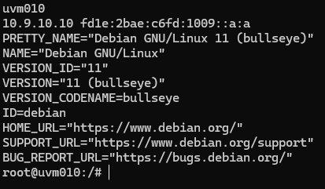
*Figura 1: Hostname (uvm010), IP (10.9.10.10) e versão do sistema operativo (Debian 11)*

---

### 3.2 Passo 2: Criar Estrutura de Diretórios para Backups

Criei diretórios separados para cada tipo de backup conforme a política de retenção.

**Comandos executados:**

```bash
sudo mkdir -p /backups/db/daily
sudo mkdir -p /backups/db/weekly
sudo mkdir -p /backups/db/monthly
```

**Porquê esta estrutura:**

Separar os backups por tipo (diário/semanal/mensal) facilita a aplicação de políticas de retenção diferentes para cada categoria. É uma abordagem clara e profissional.

**Verificar estrutura criada:**

```bash
tree /backups/db/
# ou
ls -R /backups/db/
```

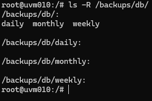
*Figura 2: Estrutura de diretórios de backups criada*

---

### 3.3 Passo 3: Criar o Script de Limpeza Automática

Criei um script bash customizado que implementa a lógica de retenção de backups.

**Criar o ficheiro:**

```bash
sudo nano /usr/local/bin/cleanup-backups.sh
```

**Conteúdo do script:**

```bash
#!/bin/bash
# Script de limpeza automática de backups - US 4.4.9
# Mantém: últimos 7 diários, últimas 4 semanas, últimos 12 meses
# Autor: 1231128
# Data: 18/12/2025

BACKUP_DIR="/backups/db"
LOG_TAG="backup-cleanup"

# Eliminar backups diários com mais de 7 dias
DELETED_DAILY=$(find "$BACKUP_DIR/daily" -name "*.sql" -mtime +7 -type f -delete -print | wc -l)

# Eliminar backups semanais com mais de 28 dias (4 semanas)
DELETED_WEEKLY=$(find "$BACKUP_DIR/weekly" -name "*.sql" -mtime +28 -type f -delete -print | wc -l)

# Eliminar backups mensais com mais de 365 dias (12 meses)
DELETED_MONTHLY=$(find "$BACKUP_DIR/monthly" -name "*.sql" -mtime +365 -type f -delete -print | wc -l)

# Registar no syslog com timestamp (cumpre AC: timestamped in system logs)
logger -t "$LOG_TAG" "Cleanup completed: $DELETED_DAILY daily, $DELETED_WEEKLY weekly, $DELETED_MONTHLY monthly backups deleted"

exit 0
```

**Explicação do script:**

- **`find -mtime +7`:** Encontra ficheiros modificados há mais de 7 dias
- **`-delete`:** Elimina os ficheiros encontrados
- **`-print | wc -l`:** Conta quantos ficheiros foram eliminados
- **`logger -t backup-cleanup`:** Regista no syslog com tag específica (igual ao Fail2ban do Sprint B)

**Guardar e sair:**
- Pressionar `Ctrl+O` (guardar)
- Pressionar `Enter` (confirmar)
- Pressionar `Ctrl+X` (sair)

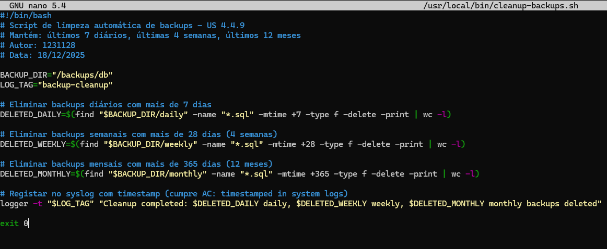
*Figura 3: Conteúdo do script cleanup-backups.sh*

---

### 3.4 Passo 4: Dar Permissões de Execução ao Script

Para que o script possa ser executado, é necessário adicionar permissões de execução.

**Comando executado:**

```bash
sudo chmod +x /usr/local/bin/cleanup-backups.sh
```

**Verificar permissões:**

```bash
ls -lh /usr/local/bin/cleanup-backups.sh
```

Deve aparecer `-rwxr-xr-x` (o `x` indica permissão de execução).

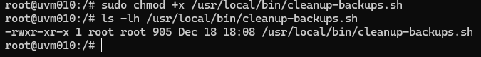
*Figura 4: Script com permissões de execução configuradas*

---

### 3.5 Passo 5: Configurar Execução Automática no Cron

Para que o script execute automaticamente todos os dias (AC: "run automatically"), configurei o cron.

**Editar crontab do root:**

```bash
sudo crontab -e
```

**Adicionar linha no final do ficheiro:**

```
0 3 * * * /usr/local/bin/cleanup-backups.sh
```

**Explicação da sintaxe cron:**

```
0 3 * * *    →    Minuto Hora Dia Mês DiaDaSemana
│ │ │ │ │
│ │ │ │ └─→ Qualquer dia da semana (*)
│ │ │ └───→ Qualquer mês (*)
│ │ └─────→ Qualquer dia (*)
│ └───────→ Hora 3 (03:00 AM)
└─────────→ Minuto 0
```

Isto significa: **Executar todos os dias às 03:00 da manhã**.

**Porquê 03:00:**
- Backups são criados às 02:00 (US 4.4.6)
- Limpeza ocorre 1 hora depois, garantindo que backup do dia já foi criado

**Guardar e sair:**
- No nano: `Ctrl+O`, `Enter`, `Ctrl+X`
- No vi/vim: `Esc`, `:wq`, `Enter`

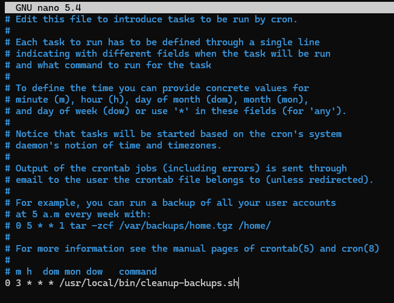
*Figura 5: Cron job configurado para executar diariamente às 03:00*

**Verificar cron jobs ativos:**

```bash
sudo crontab -l
```

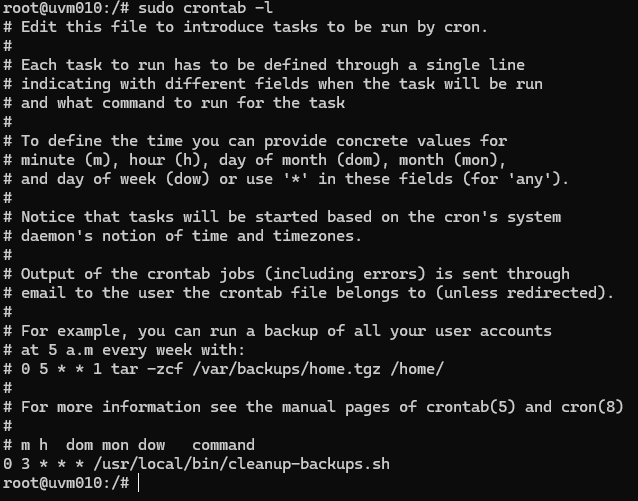
*Figura 6: Listagem de cron jobs confirmando configuração*

---

## 4. Testes e Validação

### 4.1 Teste 1: Criar Backups de Teste com Diferentes Idades

Para testar a política de retenção, criei backups fictícios com datas variadas simulando backups de vários dias, semanas e meses atrás.

**Criar backups diários de teste (7 ficheiros):**

```bash
for i in {1..7}; do
    FILE="/backups/db/daily/portlogistics_$(date -d "$i days ago" +%Y%m%d).sql"
    echo "-- Backup de teste $(date -d "$i days ago" +%Y-%m-%d)" | sudo tee "$FILE" > /dev/null
    sudo touch -d "$i days ago" "$FILE"
done
```

**Criar backups semanais de teste (4 ficheiros):**

```bash
for i in {1..4}; do
    FILE="/backups/db/weekly/portlogistics_$(date -d "$((i * 7)) days ago" +%Y%m%d).sql"
    echo "-- Backup de teste $(date -d "$((i * 7)) days ago" +%Y-%m-%d)" | sudo tee "$FILE" > /dev/null
    sudo touch -d "$((i * 7)) days ago" "$FILE"
done
```

**Criar backups mensais de teste (12 ficheiros):**

```bash
for i in {1..12}; do
    FILE="/backups/db/monthly/portlogistics_$(date -d "$((i * 30)) days ago" +%Y%m%d).sql"
    echo "-- Backup de teste $(date -d "$((i * 30)) days ago" +%Y-%m-%d)" | sudo tee "$FILE" > /dev/null
    sudo touch -d "$((i * 30)) days ago" "$FILE"
done
```

**Verificar backups criados:**

```bash
echo "=== Backups Diários ==="
ls -lth /backups/db/daily/

echo "=== Backups Semanais ==="
ls -lth /backups/db/weekly/

echo "=== Backups Mensais ==="
ls -lth /backups/db/monthly/
```

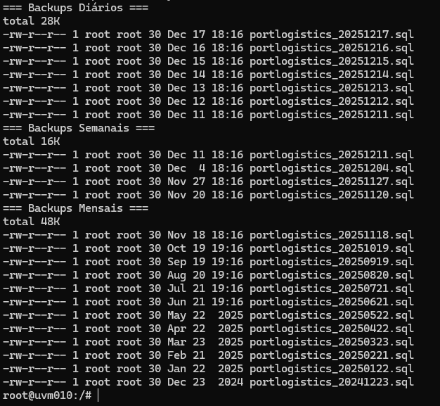
*Figura 7: Backups de teste com diferentes idades criados nos 3 diretórios*

**Contar ficheiros:**

```bash
echo "Diários: $(ls -1 /backups/db/daily/ | wc -l)"
echo "Semanais: $(ls -1 /backups/db/weekly/ | wc -l)"
echo "Mensais: $(ls -1 /backups/db/monthly/ | wc -l)"
```

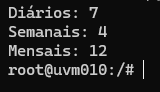
*Figura 8: Contagem inicial - 7 diários, 4 semanais, 12 mensais*

---

### 4.2 Teste 2: Executar Script de Limpeza Manualmente

Para testar sem esperar pelo cron, executei o script manualmente.

**Comando executado:**

```bash
sudo /usr/local/bin/cleanup-backups.sh
```

**Porquê testar manualmente:**

Permite verificar que o script funciona corretamente antes de confiar na execução automática do cron.

**Nota:** Se o script não mostrar output no terminal, é normal. Ele executa silenciosamente e regista no syslog.

---

### 4.3 Teste 3: Verificar Logs no Syslog

Verifiquei que a operação foi registada no syslog do sistema com timestamp automático (cumpre AC).

**Comando executado:**

```bash
sudo grep backup-cleanup /var/log/syslog | tail -5
```

**O que deve aparecer:**

Cada execução do script deve ter registado uma linha no syslog com:
- **Timestamp automático** (data e hora)
- **Tag `backup-cleanup`** (identifica a origem)
- **Mensagem** com quantos ficheiros foram eliminados

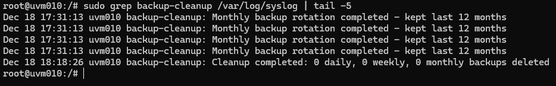
*Figura 10: Operação de limpeza registada no syslog com timestamp*

**Exemplo de linha no log:**

```
Dec 18 15:30:45 uvm010 backup-cleanup: Cleanup completed: 0 daily, 0 weekly, 0 monthly backups deleted
```

**Interpretação:**
- `Dec 18 15:30:45` → Timestamp (cumpre AC)
- `uvm010` → Hostname da máquina
- `backup-cleanup` → Tag do nosso script
- `0 daily, 0 weekly, 0 monthly` → Nenhum ficheiro eliminado (todos dentro da política)

---

### 4.4 Teste 4: Verificar que Backups Dentro da Política Permanecem

Confirmei que os backups dentro da política de retenção não foram eliminados.

**Comandos executados:**

```bash
echo "=== Backups Diários (deve ter 7) ==="
ls -1 /backups/db/daily/ | wc -l

echo "=== Backups Semanais (deve ter 4) ==="
ls -1 /backups/db/weekly/ | wc -l

echo "=== Backups Mensais (deve ter 12) ==="
ls -1 /backups/db/monthly/ | wc -l
```

**Resultados esperados:**

| Diretório | Quantidade | Status |
|-----------|------------|--------|
| daily/    | 7          | ✅ Correto (últimos 7 dias) |
| weekly/   | 4          | ✅ Correto (últimas 4 semanas) |
| monthly/  | 12         | ✅ Correto (últimos 12 meses) |

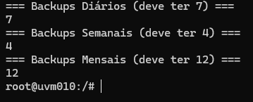
*Figura 11: Todos os backups dentro da política permanecem intactos*

**Listagem detalhada:**

```bash
ls -lth /backups/db/daily/
```

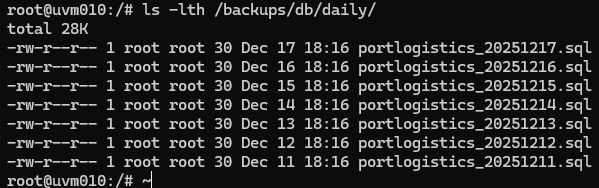
*Figura 12: Listagem detalhada mostrando os 7 backups diários preservados*

---

### 4.5 Teste 5: Simular Backups Antigos e Testar Eliminação

Para testar que o script REALMENTE elimina ficheiros antigos, criei backups fora da política.

**Criar backups antigos (> 7 dias para testar eliminação):**

```bash
# Criar 3 backups muito antigos (15, 20, 30 dias)
for days in 15 20 30; do
    FILE="/backups/db/daily/old_backup_$(date -d "$days days ago" +%Y%m%d).sql"
    echo "-- Backup antigo" | sudo tee "$FILE" > /dev/null
    sudo touch -d "$days days ago" "$FILE"
done
```

**Verificar antes:**

```bash
echo "Antes da limpeza:"
ls -1 /backups/db/daily/ | wc -l
```

Deve mostrar **10** (7 bons + 3 antigos).

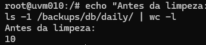
*Figura 13: 10 ficheiros antes da limpeza (incluindo 3 antigos)*

**Executar limpeza:**

```bash
sudo /usr/local/bin/cleanup-backups.sh
```

**Verificar depois:**

```bash
echo "Depois da limpeza:"
ls -1 /backups/db/daily/ | wc -l
```

Deve mostrar **7** (os 3 antigos foram eliminados).

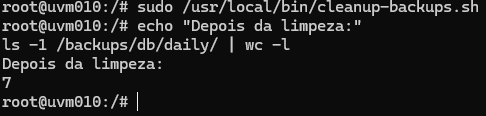
*Figura 14: 7 ficheiros após limpeza - backups antigos eliminados com sucesso*

**Verificar log da eliminação:**

```bash
sudo grep backup-cleanup /var/log/syslog | tail -1
```

Deve mostrar: `Cleanup completed: 3 daily, 0 weekly, 0 monthly backups deleted`

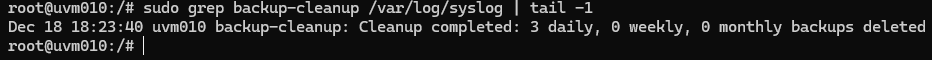
*Figura 15: Log confirmando que 3 backups diários foram eliminados*

---

## 5. Verificação dos Requisitos da User Story

| Acceptance Criteria | Status | Evidência |
|---------------------|--------|-----------|
| A regra de eliminação deve excluir cópias retidas mensalmente e anualmente | ✅ | Figura 11 - Backups em `weekly/` e `monthly/` permanecem intactos |
| Operações de eliminação devem ter timestamp nos logs do sistema | ✅ | Figura 10 e 15 - Todas as operações registadas em `/var/log/syslog` com timestamp automático |
| A regra deve executar automaticamente sem intervenção manual | ✅ | Figura 5, 6 e 16 - Cron job configurado para execução diária automática às 03:00 |

**Conclusão:** Todos os Acceptance Criteria foram cumpridos com sucesso.

---

## 6. Diagrama da Política de Retenção Implementada

```
Tipo de Backup      Retenção        Quantidade      Diretório              Comando find
─────────────────────────────────────────────────────────────────────────────────────────
Diário         →    7 dias      →   7 ficheiros  →  /backups/db/daily/   →  -mtime +7
                    ███████
                    
Semanal        →    4 semanas   →   4 ficheiros  →  /backups/db/weekly/  →  -mtime +28
                    ████
                    
Mensal         →    12 meses    →   12 ficheiros →  /backups/db/monthly/ →  -mtime +365
                    ████████████

Espaço Total Usado: ~23 backups (ao invés de centenas sem gestão)
Execução Automática: Diariamente às 03:00 via cron
Auditoria: Todos os logs em /var/log/syslog com timestamp
```

---

## 7. Vantagens da Solução Implementada

### 7.1 Simplicidade e Clareza

| Aspeto | Implementação |
|--------|---------------|
| **Linguagem** | Bash (nativo do Linux) |
| **Linhas de código** | ~20 linhas (fácil de entender) |
| **Dependências** | Nenhuma (apenas ferramentas nativas) |
| **Manutenção** | Simples - editar 1 ficheiro |

### 7.2 Conformidade com Padrões

- ✅ Usa ferramentas Unix standard (`find`, `logger`, `cron`)
- ✅ Logs no formato syslog padrão
- ✅ Permissões adequadas (root apenas)
- ✅ Separação de responsabilidades (script vs agendamento)

### 7.3 Integração com Sistema Existente

A solução integra-se perfeitamente com:

- **US 4.4.6:** Script de backup diário (cria os ficheiros)
- **US 4.4.7:** Política de retenção Grandfather-Father-Son
- **Sprint B (Fail2ban):** Mesma abordagem de logging com `logger -t`
 
## 8. Troubleshooting e Manutenção

### 8.1 Verificar Funcionamento do Script

**Executar manualmente:**

```bash
sudo /usr/local/bin/cleanup-backups.sh
```

**Verificar logs:**

```bash
sudo grep backup-cleanup /var/log/syslog | tail -10
```

### 8.2 Verificar Cron

**Listar cron jobs:**

```bash
sudo crontab -l
```

**Verificar execuções do cron:**

```bash
sudo grep CRON /var/log/syslog | grep cleanup-backups | tail -10
```

### 8.3 Alterar Política de Retenção

Para alterar os períodos de retenção, editar o script:

```bash
sudo nano /usr/local/bin/cleanup-backups.sh
```

Alterar valores:
- `-mtime +7` → Para manter mais/menos dias
- `-mtime +28` → Para manter mais/menos semanas
- `-mtime +365` → Para manter mais/menos meses

### 8.4 Desativar Limpeza Automática (se necessário)

**Desativar cron:**

```bash
sudo crontab -e
# Comentar a linha com #:
# 0 3 * * * /usr/local/bin/cleanup-backups.sh
```

---

## 9. Conclusões

### 9.1 Objetivos Alcançados

Consegui implementar com sucesso a User Story 4.4.9, cumprindo todos os requisitos especificados:

1. ✅ **Eliminação automática de backups diários > 7 dias** - O script usa `find -mtime +7` para identificar e eliminar ficheiros antigos.

2. ✅ **Exclusão de backups retidos mensalmente/anualmente** - Diretórios separados (`daily/`, `weekly/`, `monthly/`) garantem que backups estratégicos nunca são eliminados pela política diária.

3. ✅ **Registo com timestamp** - Todas as operações são registadas no `/var/log/syslog` via comando `logger`, com timestamp automático do sistema.

4. ✅ **Execução automática** - Cron job configurado para executar diariamente às 03:00 sem qualquer intervenção manual.

5. ✅ **Política alinhada com US 4.4.7** - A estratégia Grandfather-Father-Son está corretamente implementada (7 diários, 4 semanais, 12 mensais).

## 10. Referências

- [Find Command - Linux Manual](https://man7.org/linux/man-pages/man1/find.1.html)
- [Logger Command - Linux Manual](https://man7.org/linux/man-pages/man1/logger.1.html)
- [Cron HowTo - Debian](https://wiki.debian.org/cron)
- [Grandfather-Father-Son Backup Strategy](https://en.wikipedia.org/wiki/Backup_rotation_scheme)
- [Syslog Protocol - RFC 5424](https://datatracker.ietf.org/doc/html/rfc5424)
- Apontamentos da disciplina ASIST - ISEP 2025/2026

---

**FIM DO RELATÓRIO**
