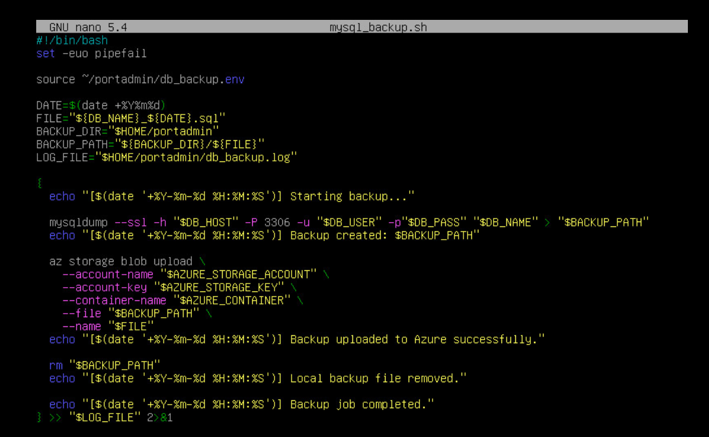
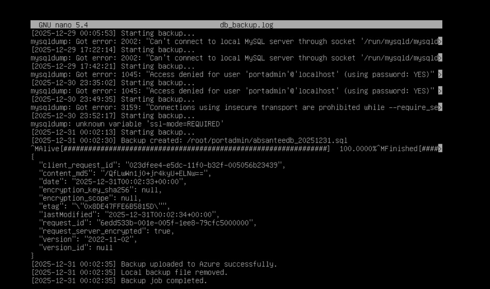
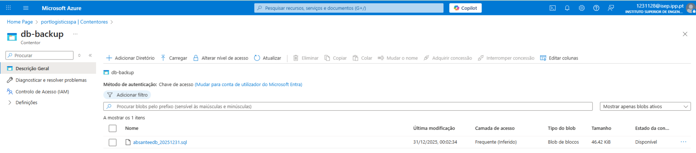

# US 4.4.6 – Backup Automático da Base de Dados para a Cloud

## 1. Análise da User Story

### 1.1. Descrição
Esta user story visa garantir que existe um mecanismo automático, seguro e rastreável de backup da base de dados MySQL para a cloud (Azure Blob Storage), com logs detalhados e boas práticas de segurança.

### 1.2. Acceptance Criteria
- O backup deve ser automático (cron)
- O ficheiro deve seguir o formato `<db_name>_yyyymmdd.sql`
- Os backups devem ser enviados para Azure Blob Storage
- Logs de sucesso/erro com timestamp
- As credenciais devem estar fora do controlo de versões

---

## 2. Implementação

### 2.1. Preparação do Ambiente
- Criação de diretório seguro para scripts e variáveis (`~/portadmin`)
- Ficheiro `db_backup.env` com variáveis sensíveis:
  ```env
  DB_USER="portadmin"
  DB_PASS="<DB_PASSWORD>"
  DB_NAME="absanteedb"
  AZURE_STORAGE_ACCOUNT="portlogisticsspa"
  AZURE_STORAGE_KEY="..."
  AZURE_CONTAINER="db-backup"
  DB_HOST="portlogistics-mysql-4325.mysql.database.azure.com"
  ```

### 2.2. Script de Backup
- Script bash robusto com `set -euo pipefail`
- Utilização de `mysqldump` com SSL para Azure:
  ```bash
  mysqldump --ssl -h "$DB_HOST" -P 3306 -u "$DB_USER" -p"$DB_PASS" "$DB_NAME" > "$BACKUP_PATH"
  ```
- Upload automático para Azure Blob Storage com a CLI Azure
- Logs detalhados em `~/portadmin/db_backup.log`

#### Exemplo de Script


#### Ficheiro de Variáveis
> _Screenshot of the variables file omitted: it contained credentials._

#### Log de Execução


#### Evidência do Backup no Portal Azure


### 2.3. Resolução de Problemas
- Erros de ligação local: MySQL não estava instalado/local
- Erros de permissões: Garantido que o utilizador existe e tem permissões
- Erro de SSL: Azure exige ligação segura, resolvido com `--ssl`
- Erro de variáveis: Ajustado para versões antigas do cliente MySQL

### 2.4. Testes e Validação
- Teste manual do script
- Verificação do ficheiro no Azure Blob Storage
- Consulta dos logs para garantir sucesso

### 2.5. Automatização
- Agendamento do script via `crontab` para execução diária

---

## 3. Conclusão
A user story foi cumprida: o backup é realizado automaticamente, enviado para a cloud, com logs detalhados e segurança nas credenciais. O processo é robusto, rastreável e facilmente adaptável a outros ambientes.

---