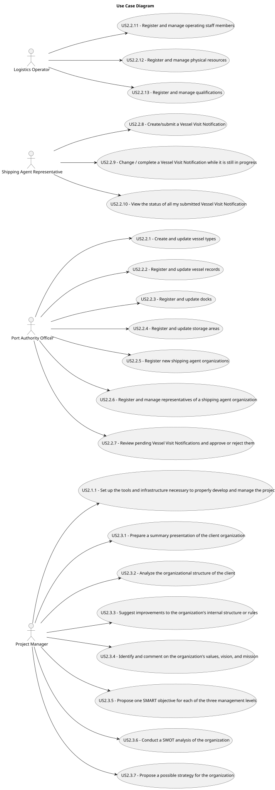

# Use Case Diagram (UCD)

**In the scope of this project, there is a direct relationship of _1 to 1_ between Use Cases (UC) and User Stories (US).**

However, be aware, this is a pedagogical simplification. On further projects and course units there may also exist _1 to N **and/or** N to 1_ relationships between UC and US.

**Insert below the Use Case Diagram in a SVG format**

**For each UC/US, it must be provided evidences of applying main activities of the software development process (requirements, analysis, design, tests and code). Gather those evidences on a separate file for each UC/US and set up a link as suggested below.**

# Use Cases / User Stories

| UC/US    | Description                                                   |                   
|:---------|:--------------------------------------------------------------|
| US2.1.1  | As a Project Manager, I want the team to set up the tools and infrastructure necessary to properly develop and manage the project, employing engineering best practices. |
| US2.2.1  | As a Port Authority Officer, I want to create and update vessel types. |
| US2.2.2  | As a Port Authority Officer, I want to register and update vessel records. |
| US2.2.3  | As a Port Authority Officer, I want to register and update docks. |
| US2.2.4  | As a Port Authority Officer, I want to register and update storage areas. |
| US2.2.5  | As a Port Authority Officer, I want to register new shipping agent organizations. |
| US2.2.6  | As a Port Authority Officer, I want to register and manage representatives of a shipping agent organization. |
| US2.2.7  | As a Port Authority Officer, I want to review pending Vessel Visit Notifications and approve or reject them. |
| US2.2.8  | As a Shipping Agent Representative, I want to create/submit a Vessel Visit Notification. |
| US2.2.9  | As a Shipping Agent Representative, I want to change / complete a Vessel Visit Notification while it is still in progress. |
| US2.2.10 | As a Shipping Agent Representative, I want to view the status of all my submitted Vessel Visit Notifications (in progress, pending, approved with current dock assignment, or rejected with reason). |
| US2.2.11 | As a Logistics Operator, I want to register and manage operating staff members (create, update, deactivate). |
| US2.2.12 | As a Logistics Operator, I want to register and manage physical resources (create, update, deactivate). |
| US2.2.13 | As a Logistics Operator, I want to register and manage qualifications (create, update). |
| US2.3.1  | As a Project Manager, I want the team to prepare a summary presentation of the client organization. |
| US2.3.2  | As a Project Manager, I want the team to analyze the organizational structure of the client. |
| US2.3.3  | As a Project Manager, I want the team to suggest improvements to the organization’s internal structure or rules. |
| US2.3.4  | As a Project Manager, I want the team to identify and comment on the organization’s values, vision, and mission. |
| US2.3.5  | As a Project Manager, I want the team to propose one SMART objective for each of the three management levels. |
| US2.3.6  | As a Project Manager, I want the team to conduct a SWOT analysis of the organization. |
| US2.3.7  | As a Project Manager, I want the team to propose a possible strategy for the organization. |
