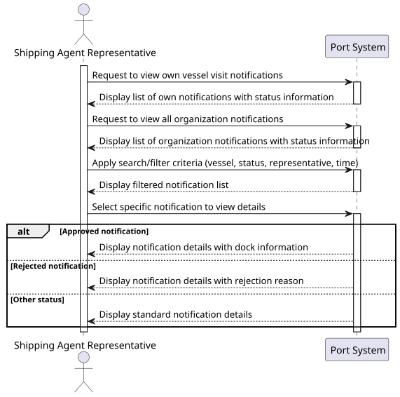
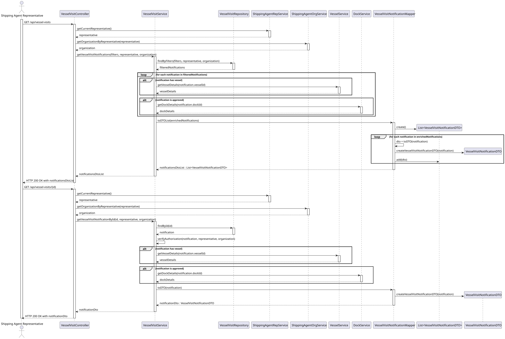
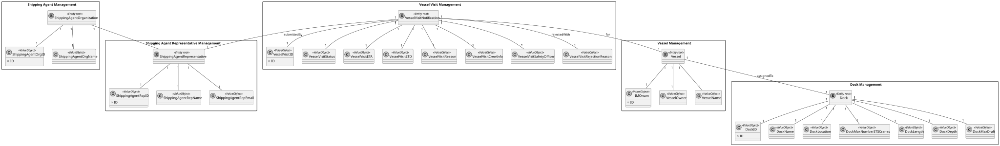

# US 2.2.10 - View Vessel Visit Notification Status

## 1. User Story Description

**As a** Shipping Agent Representative  
**I want to** view the status of all my submitted Vessel Visit Notifications (in progress, pending, approved with current dock assignment, or rejected with reason)  
**So that** I am always informed about the decisions of the Port Authority

## 2. Acceptance Criteria

### AC1: View Own Notifications
- The Shipping Agent Representative can view all Vessel Visit Notifications they have submitted
- Status information must include:
  - **In Progress**: Notification is being prepared/edited
  - **Pending**: Submitted and awaiting Port Authority decision
  - **Approved**: Approved by Port Authority with assigned dock information
  - **Rejected**: Rejected by Port Authority with reason provided

### AC2: View Organization Notifications
- The Shipping Agent Representative can view Vessel Visit Notifications submitted by other representatives working for the same shipping agent organization
- Access is restricted to notifications within the same organization only

### AC3: Search and Filter Functionality
- Vessel Visit Notifications must be searchable and filterable by:
  - **Vessel**: Search by vessel name or IMO number
  - **Status**: Filter by notification status (in progress, pending, approved, rejected)
  - **Representative**: Filter by the representative who submitted the notification
  - **Time**: Filter by submission date, approval date, or expected arrival date

### AC4: Status Information Display
- For **Approved** notifications: Display assigned dock information
- For **Rejected** notifications: Display rejection reason provided by Port Authority Officer
- Display timestamps for status changes (submitted, approved/rejected)

## 3. System Sequence Diagram (SSD)

## 4. Sequence Diagram (SD)

## 5. Business Rules

### BR1: Data Access Restrictions
- Representatives can only view notifications from their own shipping agent organization
- Personal data of other representatives should be limited to necessary information (name, not sensitive data)

### BR2: Real-time Status Updates
- Status information should be updated in real-time when Port Authority makes decisions
- System should provide notifications when status changes occur

### BR3: Audit Trail
- All status changes must be logged with timestamps and responsible officer information
- Historical status information should be preserved for auditing purposes

## 6. Domain Model

This user story involves the following domain aggregates and their relationships:

## 7. Dependencies

### 7.1 Upstream Dependencies
- **US 2.2.5**: Register shipping agent organizations (needed for organization-based filtering)
- **US 2.2.6**: Manage representatives (needed for representative information)
- **US 2.2.2**: Register vessels (needed for vessel information)
- **US 2.2.8**: Create Vessel Visit Notification (needed for notifications to view)

### 7.2 Downstream Dependencies
- Authentication system (to identify current representative and their organization)
- Authorization system (to enforce organization-based access control)
