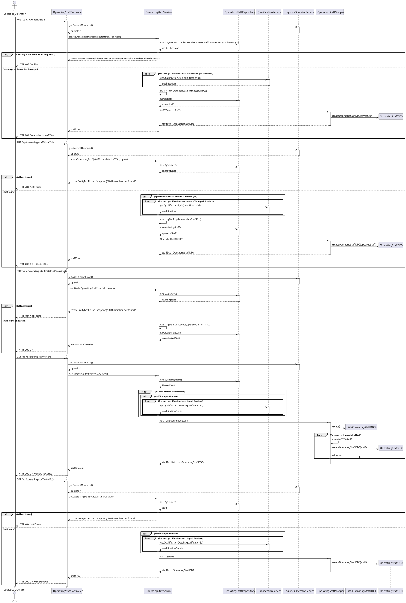
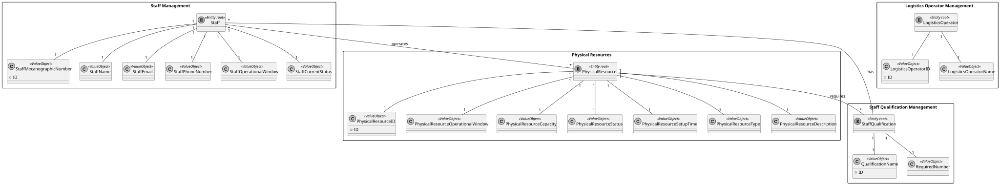

# US 2.2.11 - Register and Manage Operating Staff Members

## 1. User Story Description

**As a** Logistics Operator  
**I want to** register and manage operating staff members (create, update, deactivate)  
**So that** the system can accurately reflect staff availability and ensure that only qualified personnel are assigned to resources during scheduling

## 2. Acceptance Criteria

### AC1: Staff Member Registration
- Each staff member must have a unique mecanographic number (ID), short name, contact details (email, phone), qualifications, operational window, and current status (e.g., available, unavailable)
- The system must validate that all required fields are provided during registration
- Email and phone number must follow standard validation formats
- Mecanographic number must be unique across all staff members

### AC2: Staff Member Updates
- Logistics Operators can update staff member information including contact details, qualifications, operational window, and status
- Updates must preserve the mecanographic number as the unique identifier
- Changes to qualifications must reference existing qualifications in the system
- Operational window updates must follow standard time format validation

### AC3: Staff Member Deactivation/Reactivation
- Deactivation/reactivation must not delete staff data but preserve it for audit and historical planning purposes
- Deactivated staff members cannot be assigned to new tasks but their historical assignments remain visible
- Reactivation restores full functionality while maintaining historical records
- Status changes must be logged with timestamp and operator information

### AC4: Search and Filter Functionality
- Staff members must be searchable and filterable by:
  - **ID**: Search by mecanographic number (exact match)
  - **Name**: Search by short name (partial match)
  - **Status**: Filter by current status (available, unavailable, on leave, etc.)
  - **Qualifications**: Filter by specific qualifications or certification types

### AC5: Qualification Management Integration
- Staff qualifications must reference existing qualifications registered in the system (US 2.2.13 dependency)
- Multiple qualifications can be assigned to a single staff member
- Qualification assignments must be validated against the qualification registry

## 3. System Sequence Diagram (SSD)

## 4. Sequence Diagram (SD)

## 5. Business Rules

### BR1: Mecanographic Number Uniqueness
- Each staff member must have a unique mecanographic number that serves as their primary identifier
- The system must prevent duplicate mecanographic numbers across all staff records
- Mecanographic numbers cannot be changed once assigned

### BR2: Qualification Validation
- Staff members can only be assigned qualifications that exist in the system qualification registry
- Qualification assignments must be validated at the time of staff registration or update
- Removing qualifications from staff members requires validation that they are not currently assigned to resources requiring those qualifications

### BR3: Operational Window Constraints
- Operational windows must be defined on a weekly basis with specific time periods
- Time periods must not overlap within the same day for the same staff member
- Operational windows affect staff availability for resource assignment and task scheduling

### BR4: Status Management
- Status changes must be tracked with timestamps and operator information for audit purposes
- Inactive staff cannot be assigned to new operational tasks
- Staff status affects their availability in scheduling algorithms and resource allocation

### BR5: Data Preservation for Audit
- Staff member data must never be permanently deleted from the system
- Historical assignments and qualification records must be preserved even after deactivation
- Audit trails must maintain complete records of all staff-related operations and changes

## 6. Domain Model

## 7. Dependencies

### 7.1 Upstream Dependencies
- **US 2.2.13**: Register and manage qualifications (needed for staff qualification assignment)
- Authentication system (to identify current Logistics Operator)
- Authorization system (to enforce role-based access control)

### 7.2 Downstream Dependencies
- **US 2.2.12**: Register and manage physical resources (staff will be assigned to resources)
- Scheduling and planning algorithms (will use staff availability and qualifications)
- Task assignment system (will validate staff qualifications against resource requirements)

